# Code or catalog? How we decided what an AI agent draws with

*Divergenz. November 2026.*

When you ask an AI agent a question whose honest answer is a chart, three numbers and one sentence of advice, what should come back? Most products answer with a wall of prose and a markdown table. A few let the model write a small program that draws something. A newer school has the model fill in a description that the application draws itself.

We build Piary, and we had to pick. We did not want to pick by taste, so we built the options side by side, had them judged blind, and then ran a control that took apart our own first result. This article is the story of that decision: what we compared, what we measured, where we were wrong, and what we shipped.

The short version: a declarative catalog (Google's A2UI) beat free-hand code 16 to 2 in blind judging. Then a control showed that most of that lead was not the catalog at all. What survived was something less glamorous and more important.

## What Piary is

Piary is a desktop application for working with an AI agent, built on one idea: **the conversation is a document, not a chat**. A session is a plain markdown file. You write into it, the agent writes into the same file, at the place you are working, and everything either of you wrote stays editable. There is no transcript scrolling away under an input box.

<table>
<tr><td>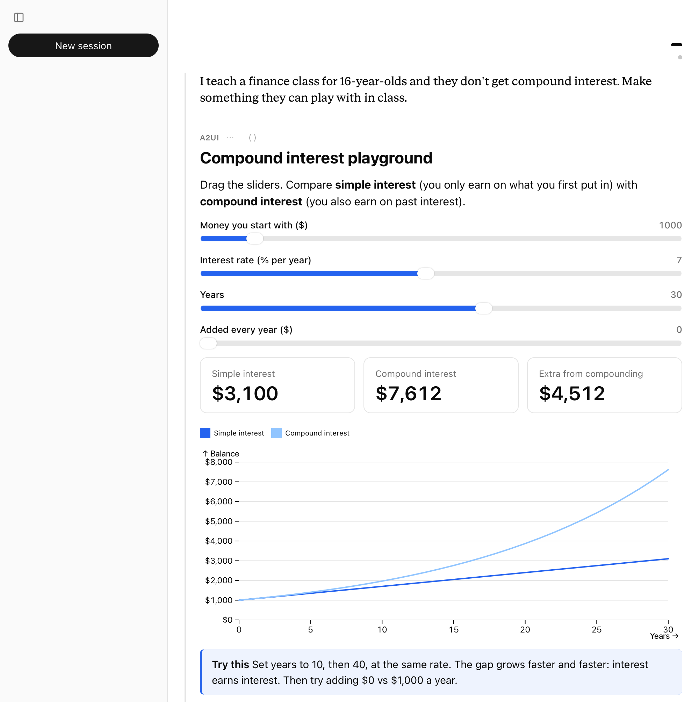</td></tr>
<tr><td><sub><b>Figure 1. A Piary document.</b> The request is text in the document, and the answer is drawn in place under it. The sliders work.</sub></td></tr>
</table>

We are not the first to be unhappy with chat. Amelia Wattenberger's [Why Chatbots Are Not the Future](https://wattenberger.com/thoughts/boo-chatbots) opens from the observation that "good tools make it clear how they should be used", and a text box does not. Geoffrey Litt wrote in [Malleable software in the age of LLMs](https://www.geoffreylitt.com/2023/03/25/llm-end-user-programming.html) that "chat is an essentially limited interaction mode, regardless of the quality of the bot". Maggie Appleton called the chatbot ["the lazy solution"](https://maggieappleton.com/lm-sketchbook/). Further back, Bret Victor's [Explorable Explanations](https://worrydream.com/ExplorableExplanations/) described the reactive document, which "integrates spreadsheet-like models into authored text", so a reader can question an author's assumptions instead of taking them on trust.

Piary is our attempt to act on that line of thinking. A few principles follow from it:

- **The file is the truth.** Machine structure lives in HTML comments, so any markdown editor shows a clean document. You own the file, and you can start a conversation by typing prose in any editor.
- **One canvas.** History is editable, because history is just the document above the caret.
- **The agent proposes, the app enforces.** The model suggests; the application checks, limits and draws.

That last principle turned out to be the one this decision rests on.

## The problem: every answer looked like a different product

Piary's agent could already draw. It did so by writing a *cell*: a small block of JavaScript, in the style of an [Observable](https://observablehq.com) notebook, that runs in the document and renders a chart, some tiles or a slider. This is the free-hand way. The agent holds the pen and can draw anything.

Two things went wrong with it.

First, the answers did not look like one product. Each cell brought its own colours (about three hand-written colour values per answer), its own layout and whatever typeface the charting library defaulted to. Second, code can fail. When it does, the reader does not get a weaker answer; they get a red error and a block of source code.

<table>
<tr><th width="50%">Free-hand: a support desk’s week</th><th width="50%">Free-hand: a compound-interest explainer</th></tr>
<tr><td valign="top">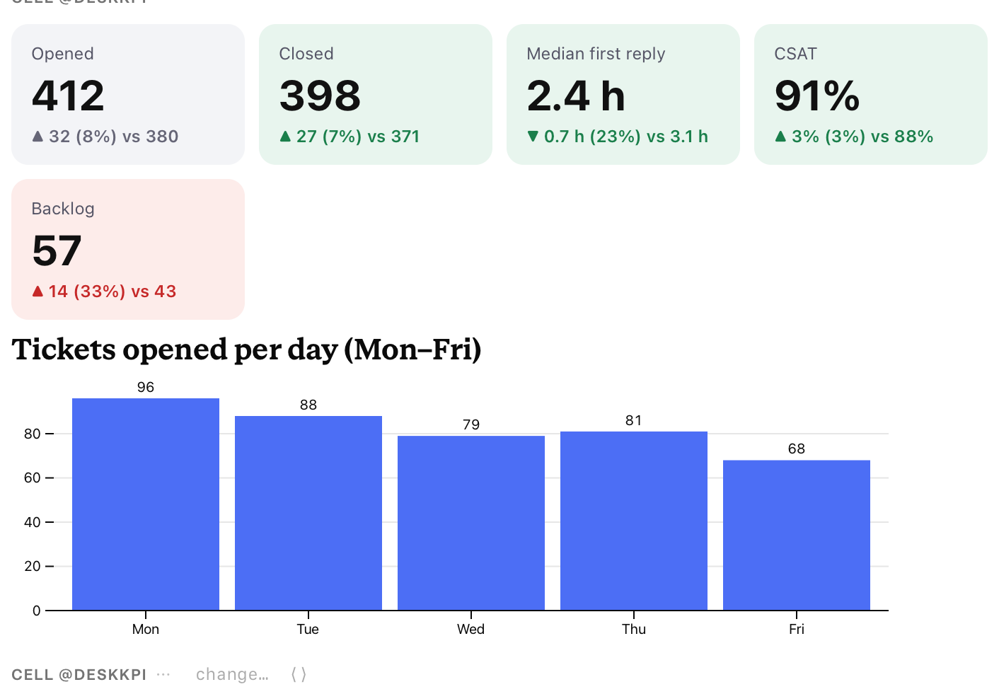</td><td valign="top">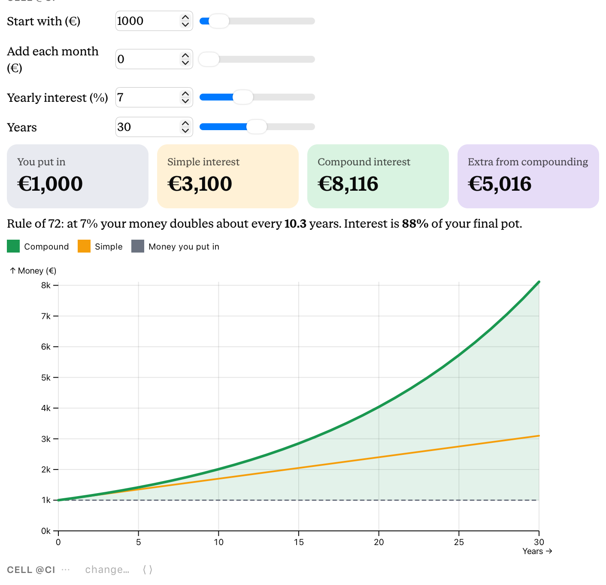</td></tr>
<tr><td colspan="2"><sub><b>Figure 2. Two free-hand answers, from the same agent on the same day.</b> Each one is reasonable on its own. Side by side they share no palette, no type and no layout. Most free-hand answers rendered like these; 3 of 18 showed a failing cell instead. The data in all our test requests is invented.</sub></td></tr>
</table>

## Two schools of generative UI

The industry has not settled this either, and it is split along the same line.

**The free-form school** lets the model write real code. Google Research's [Generative UI](https://research.google/blog/generative-ui-a-rich-custom-visual-interactive-user-experience-for-any-prompt/) work has the model emit raw HTML, CSS and JavaScript for each prompt; in its human evaluation ([paper](https://generativeui.github.io/static/pdfs/paper.pdf)), raters put those results well ahead of plain text and markdown answers, and close behind sites made by human experts. Anthropic's Artifacts, Vercel's v0 and [MCP Apps](https://blog.modelcontextprotocol.io/posts/2025-11-21-mcp-apps/) (HTML in a sandboxed frame) live here too. The argument is expressiveness, and familiarity: models have seen enormous amounts of HTML and React, and [CodeAct](https://arxiv.org/abs/2402.01030) found agents that act through code succeed up to 20% more often than agents that act through JSON or text.

**The declarative school** has the model send data, and keeps the drawing on the application's side. Google's [A2UI](https://developers.googleblog.com/en/introducing-a2ui-an-open-project-for-agent-driven-interfaces/) is the best-known example. In its announcement's words, "A2UI is a declarative data format, not executable code", and "the agent can only request to render components from that catalog", a catalog the client defines and trusts. Vercel's json-render and Thesys's OpenUI follow the same shape. The argument is control: security, brand consistency, predictability.

Before building anything we reviewed what had been measured. We found three things.

- **We found no study comparing the two on how the result looks.** Every number published for declarative formats measures whether the output is *valid*, not whether it is *good*, and nearly all of those numbers come from the vendor of the format being measured.
- **The strongest quality evidence favoured free-form code**, namely the Generative UI study above. Its consistent look came from a detailed style section in the prompt.
- **Everyone's production recipe is the same underneath:** design tokens, a small set of components and a written style guide. [OpenAI's Apps SDK guidelines](https://developers.openai.com/apps-sdk/concepts/ui-guidelines), v0's [design systems](https://v0.app/docs/design-systems) and Anthropic's [frontend design skill](https://claude.com/blog/improving-frontend-design-through-skills) all land there.

So the open question was exactly ours: given the same tokens and the same care, does a declarative catalog produce better and more consistent answers than free-hand code with a good kit? Our first instinct, for what it is worth, was the kit: no dependencies, no new format, a medium the model already speaks.

## The experiment

We built both, as fairly as we could manage.

- **Cells as they were.** The baseline: free-hand code, no shared design.
- **The kit.** Still free-hand code, but cells are themed with Piary's design tokens and can call ten small functions of ours (a stat tile, a comparison table, a callout and so on).
- **A2UI.** The agent sends a description of a *surface* built from a catalog; the page draws it with `@a2ui/lit`, in the same tokens. A2UI's basic catalog has no chart or table, so we added five components of our own: Stat, Table, Compare, Chart and Callout.

Each arm was built by AI coding agents working from a written plan, with two rounds of polish each. Because we leaned toward the kit, the A2UI arm was briefed to be built by its advocate: the strongest version possible, not a strawman.

The test was six plain requests, each with its data inline and no styling words: a support lead's weekly numbers, a teacher's compound-interest explainer, a vendor decision, a benchmark, a founder's runway, a survey. Each arm answered each request three times on the same model (Claude Sonnet 5.5), giving 18 answers per arm.

Judging was blind. A separate session that had built none of the arms showed a judge model (Claude Opus 5.5) pairs of screenshots under random file names, with no mention of mechanisms or of an experiment. Every pair was judged twice, in both left/right orders, and a verdict that flipped with the order counted as a tie. The judge also saw one unlabeled contact sheet of all 18 answers per arm and was asked whether they read as one product.

Two details mattered later. We wrote the decision rule *before* reading any verdict: with only six independent requests, a side needs at least 14 decisive wins out of 18 to count as distinguishable from a coin flip. And we took the judge's limits seriously. The [WebDevJudge](https://arxiv.org/abs/2510.18560) paper reports that its best model judge agreed with human experts about 70% of the time, where the experts agreed with each other about 85% of the time. An LLM judge is a coarse instrument, so we looked at every screenshot ourselves as well.

## Round one: the catalog wins, clearly

<table>
<tr><td>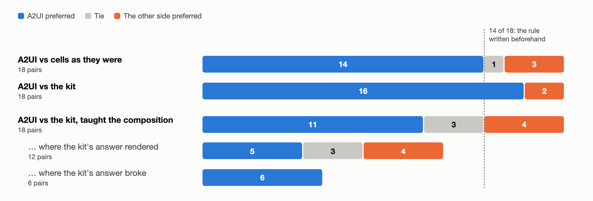</td></tr>
<tr><td><sub><b>Figure 3. What the blind judge preferred.</b> Each row is a set of answer pairs to the same requests, judged in both left/right orders; a pick that flipped with the order is a tie. The top two rows are round one, the bottom three are the control described below. The dashed line is the rule we wrote beforehand: 14 of 18. Six requests, three answers each, one model (Claude Sonnet 5.5), judged by Claude Opus 5.5.</sub></td></tr>
</table>

A2UI was preferred to the kit in 16 of 18 pairs, with no ties, and to the baseline in 14. On the contact sheets the judge scored "one product, one design language" at 5 out of 5 for A2UI, 4 for the kit and 3 for the baseline.

<table>
<tr><th width="33%">Free-hand cells</th><th width="33%">Cells with our kit</th><th width="33%">A2UI surface</th></tr>
<tr><td valign="top">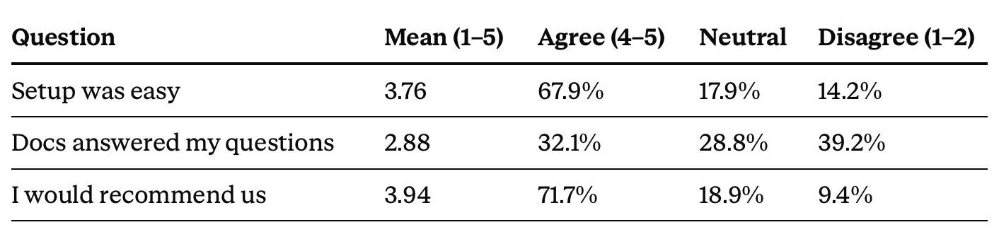</td><td valign="top">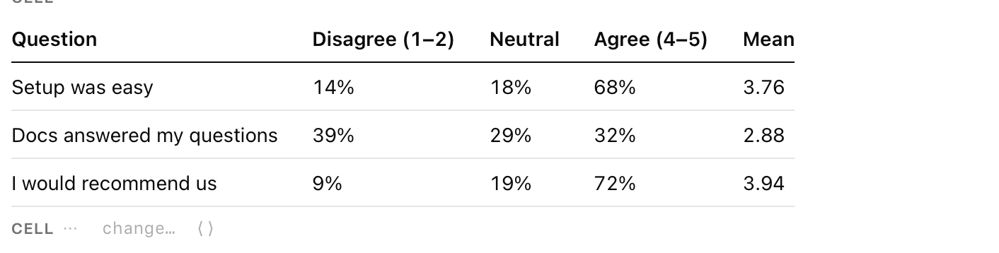</td><td valign="top">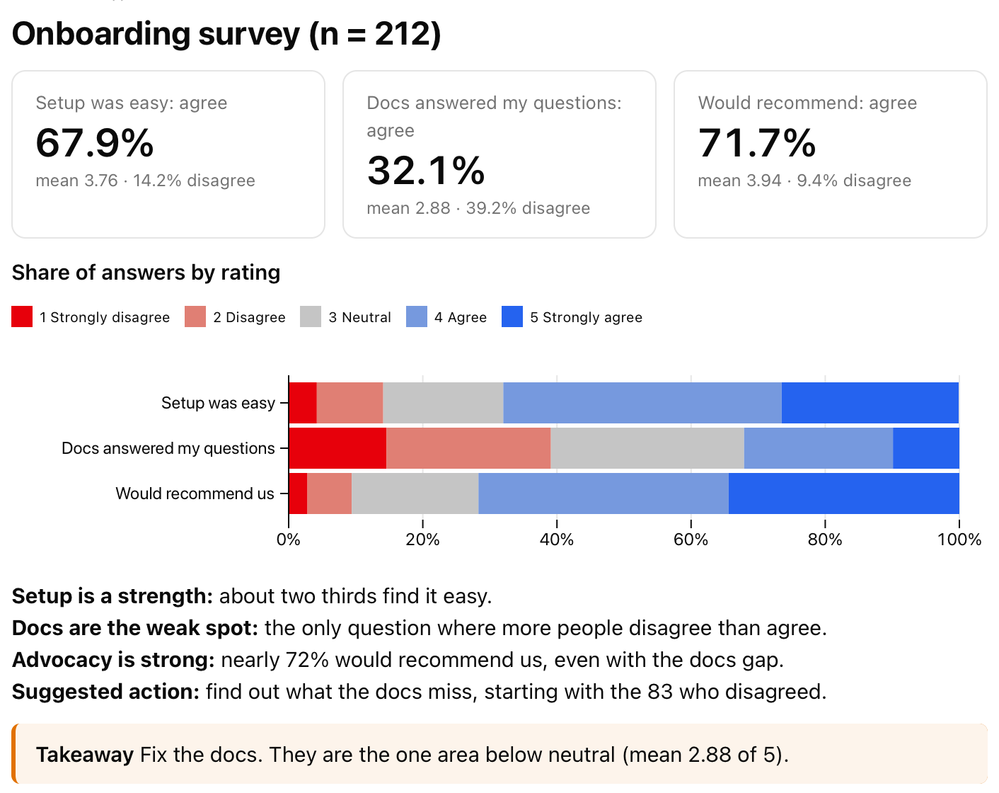</td></tr>
<tr><td colspan="3"><sub><b>Figure 4. One survey, three ways of drawing.</b> Asked to summarise a survey for a team meeting, the free-hand cells and the kit each drew a table. The A2UI answer opens with a headline, shows the three figures that matter, charts the spread and closes with a takeaway, as every A2UI answer did.</sub></td></tr>
</table>

That cleared our rule. It also contradicted the literature's expectations: the unfamiliar catalog cost nothing in validity (no payload was refused in 18 answers), and the declarative arm, not the free-form one, won on judged quality.

The detailed scores were less tidy. The kit was judged *more* consistent with Piary's look than A2UI (82% of readings against 61%), because the A2UI arm had reached for a red-to-blue ramp and green and red badges. And both designed arms read the *data* correctly less often than the plain baseline (67% and 79% against 99%). Richer presentation invited summarising mistakes, such as "+3%" for a three-point rise.

The result also carried a confound we could see but not remove. The A2UI arm's guidance was about four times larger than the kit's, and it taught a **composition**: open with a headline that states the finding, then stat tiles, then one chart, then a takeaway of under 40 words. When the judge explained its rankings, that composition is what it named. Were we measuring the medium, or the teaching?

## Round two: the control that took the result apart

We built a fourth arm to find out. It was the kit again, with one change: its guidance was taught the same composition, ported from the A2UI guide into the kit's terms. One run, no polish, same requests, same model, same judge and the same rule.

The gap fell from 16–2 to **11–4 with three ties**, below the threshold we had committed to. Then we split the pairs by a count fixed before any verdict was read: whether the kit's answer had actually rendered.

- On the 12 answers where the kit's cells ran, the two were level: A2UI 5, kit 4, three ties.
- On the 6 where a cell failed, A2UI won all six.

<table>
<tr><th width="33%">A2UI surface</th><th width="33%">Cells with our kit</th><th width="33%">Kit, taught the composition</th></tr>
<tr><td valign="top">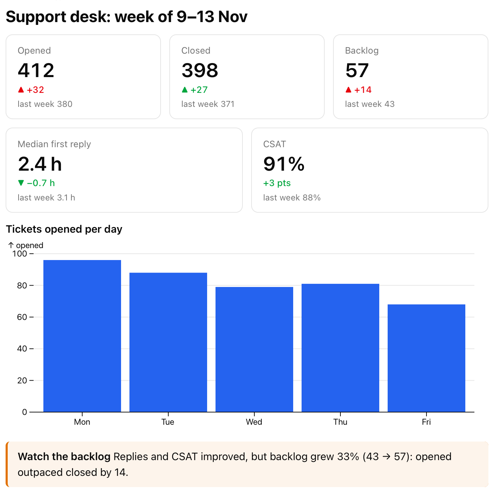</td><td valign="top">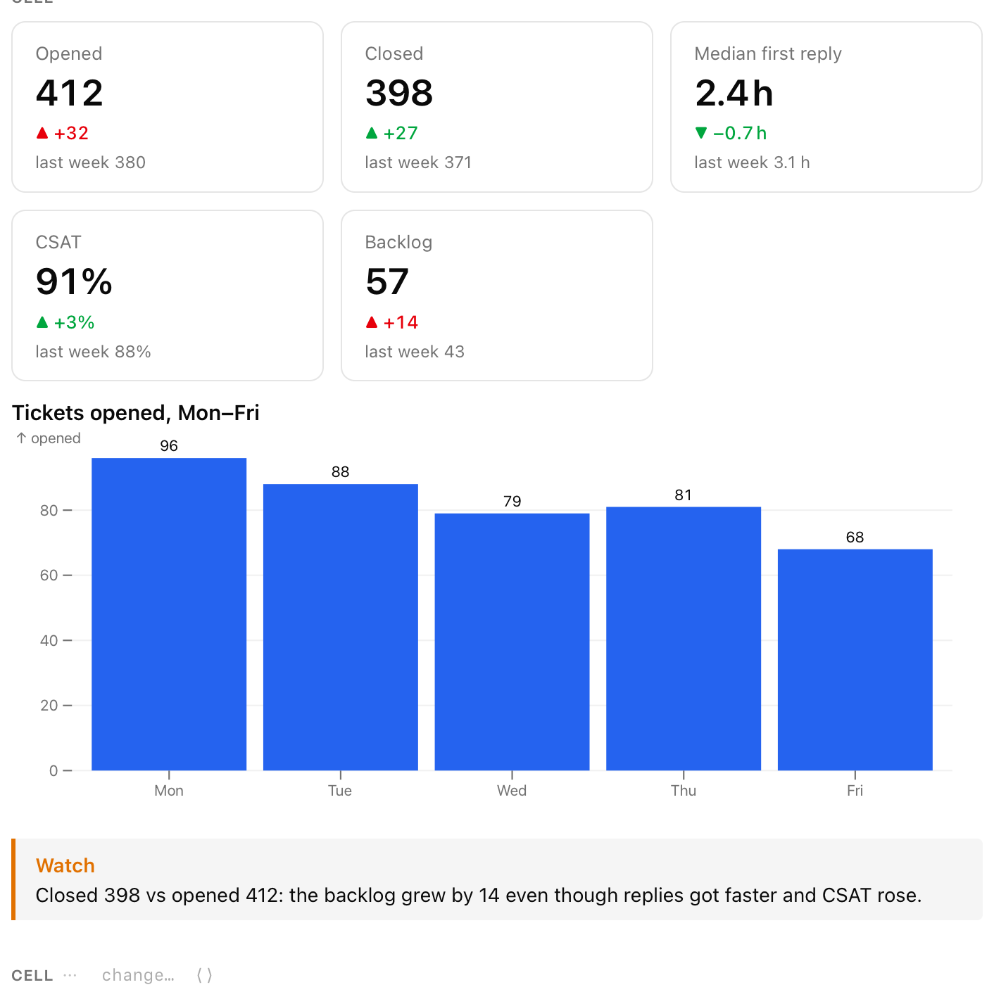</td><td valign="top">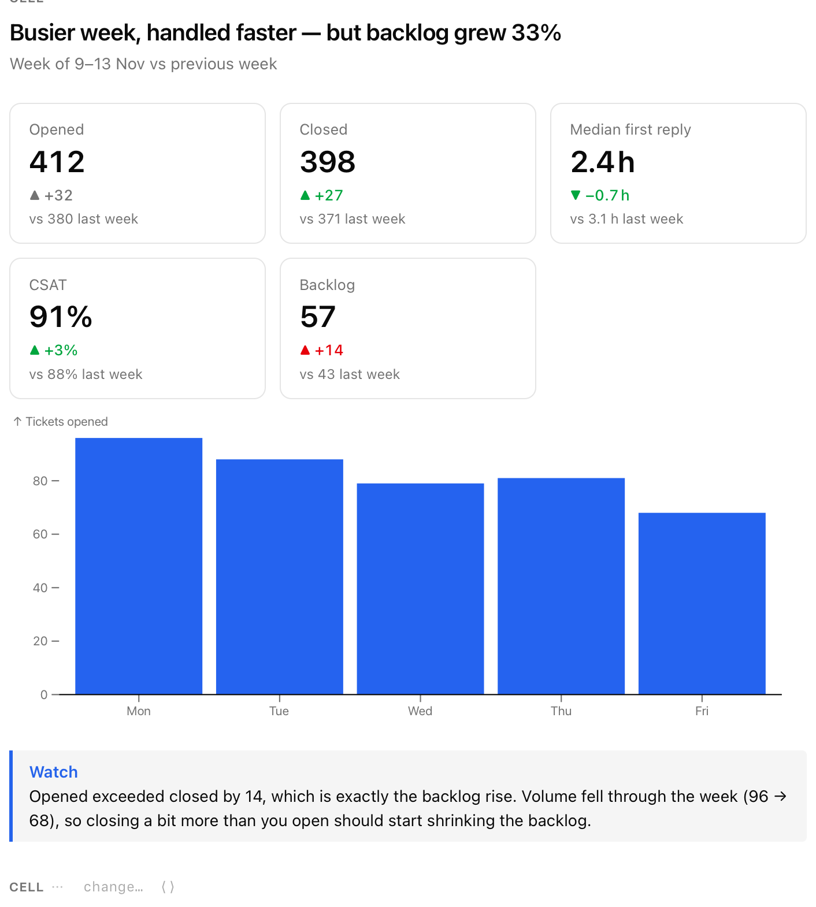</td></tr>
<tr><td colspan="3"><sub><b>Figure 5. A support desk’s week, before and after the teaching.</b> The plain kit draws tiles and a chart. Once taught the composition it adds a headline that states the finding and a takeaway, and is hard to tell from A2UI.</sub></td></tr>
</table>

So most of what the judge had liked was not the catalog. It was four sentences of editorial advice that any medium can follow. The look was mostly the teaching.

## What survived: a description can be checked before it is drawn

What remained of A2UI's lead came entirely from answers that broke. That is not a matter of look, and it is the part of the result we trust most.

<table>
<tr><td>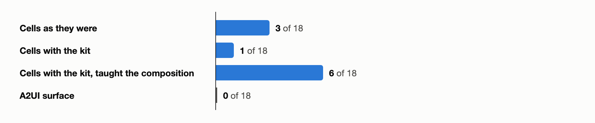</td></tr>
<tr><td><sub><b>Figure 6. Answers that showed the reader an error.</b> Of 18 answers per way of drawing, how many drew a failing cell where the answer should be, counted by eye from the screenshots. Teaching free-hand code to be more ambitious made it fail more often: the model packed data, controls and display into one cell, in shapes the notebook engine refuses. The test harness never tells the agent that a cell failed, so these are first attempts.</sub></td></tr>
</table>

The reason is structural. A cell is a program, and nothing checks a program until the page compiles and runs it, in front of the reader. A surface is data. It can be validated against the catalog by the same code that will draw it, inside the agent's tool call, before it is drawn.

<table>
<tr><td>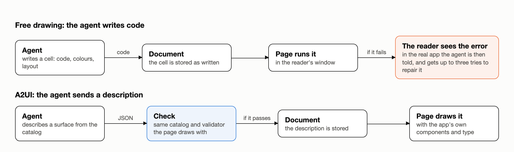</td></tr>
<tr><td><sub><b>Figure 7. Where a mistake is caught.</b> Both ways put the answer in the same document; they differ in who meets a mistake first. A surface carries no colour, no style and no code, so it can be checked before it is drawn. A refused payload comes back to the agent with the fault at an exact place, for example <code>VALIDATION_FAILED at /components/2: … Expected start | end, received 'right'</code>, and the agent sends a corrected one. The refused step stays in the document; a broken answer never does.</sub></td></tr>
</table>

A surface in the document looks like this (abridged from a real answer):

```json
{
  "components": [
    { "id": "root", "component": "Column",
      "children": ["title", "kpis", "chart", "note"] },
    { "id": "title", "component": "Text",
      "text": "## Support desk – week of 9 Nov" },
    { "id": "kpis", "component": "Row", "children": ["o", "c", "b"] },
    { "id": "o", "component": "Stat", "…": "…" }
  ]
}
```

There is no colour in it, no font and no layout arithmetic. The agent cannot drift off-palette, because it has nothing to drift with. This is "the agent proposes, the app enforces" applied to pixels.

We should be fair to code here. Our test harness never told the agent that a cell had failed. The real application does, and gives the agent up to three tries to repair it, so the six-in-eighteen figure overstates what a user would end up with. We have not yet measured by how much.

## What we decided

**A2UI is the default way Piary's agent draws an answer meant to be looked at.** Not because it is prettier, which our own control mostly explained away, but because it is the option where a mistake is caught before the reader meets it.

Around that sit several smaller decisions, each a response to something we measured.

- **Cells stay, for what a description cannot hold:** data that lives in a file, a calculation the user wants to see and edit as code, a simulation, a drawing. A catalog is a deliberate limit, and some answers do not fit inside it.
- **Derived numbers use a small formula language, not code.** A slider that changes a balance needs arithmetic. We parse a formula into a tree and walk it. Nothing the agent puts in a surface is ever evaluated as JavaScript.
- **The kit was not taken, but its lessons were.** Its theme now styles every cell, its chart defaults apply to every chart, and its control arm taught us where quality really comes from.
- **Free drawing is a mode, not a second default.** Piary can be started in free drawing, for people who prefer answers as code they can read and change. Today that is a launch setting; a control in the window is not built yet. A mode changes which guidance the agent receives, never the rendering, so a document written in one mode opens in the other. We do not teach both ways at once: each costs prompt on every turn, and two routes in one context is a choice the model makes differently every time. Measured against the old cells only, free drawing now carries about 4,700 fewer characters per turn than A2UI and broke in none of 18 answers, but 12 of those 18 were a plain table and nothing else. It is the simpler tool, not A2UI by other means.

The costs are real, and we would rather state them than have a reader discover them: four pinned runtime dependencies (three for A2UI, on a package that shipped four minor releases in five weeks, plus the charting library, which we now ship inside the app so a chart needs no network), an application bundle about 28% larger (17% for the renderer and 11% for charts, each in a chunk loaded only when needed), and roughly 4,500 characters of guidance the agent reads on every single turn.

## The words turned out to be the product

That last cost led to the most instructive part of the work. If guidance is paid for on every turn, each sentence should earn its place. So we cut the A2UI guide one step at a time, and after each cut generated 18 fresh answers, counted them and looked at them.

<table>
<tr><td>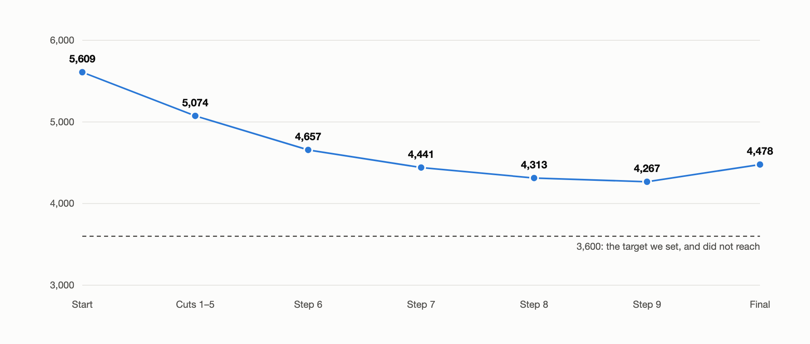</td></tr>
<tr><td><sub><b>Figure 8. Cutting the guide, one measured step at a time.</b> Characters of A2UI guidance the agent reads on every turn. Each step was followed by 18 fresh answers, counted and looked at. The guide shrank from 5,609 characters to 4,478; the dashed line is the 3,600 we aimed for and did not reach.</sub></td></tr>
</table>

Three times a cut passed every automated count and was still wrong. Once the survey charts quietly lost their colour ramp. Once the answers drew fewer stat tiles, because the example we had shortened was the thing teaching tiles. And once a request to "show the calculation so I can change the numbers" started coming back as a picture, something our visual test could not see at all, because it never exercises code.

A contract test now holds each piece of guidance to a character ceiling, and raising a ceiling requires a fresh design run. The composition sentences are marked as the last text to cut. They carry most of the judged quality, which is exactly what the control arm had shown.

## Limits

This is a small study and should be read as one.

- Six requests, three answers each, one model. Other models, especially smaller ones, may behave differently with an unfamiliar catalog.
- The judge was a model. Its rates were stable between our two judging runs, but the literature says such judges agree with experts roughly 70% of the time.
- The blinding leaked in known ways: the kit's crops show a little of the app's cell chrome, a broken answer shows code, and an A2UI surface carries its headline inside the crop while the kit wrote it as prose outside. A re-judging on whole-window screenshots kept the direction.
- 11–4 is suggestive, not parity. A sign test on the decisive pairs gives a two-sided p of about 0.12. "Not distinguishable" does not mean "equal". The rendered-only comparison rests on 12 pairs.
- The kit's guidance fix (keep data in its own cell) was written after the control run and never re-measured on these requests. A reliable kit might well match A2UI outright.
- All test data was invented, including the benchmark figures and vendor prices attached to real product names in the screenshots, and every answer was a single turn. Nothing here measures long sessions or real users.

## What we would tell another team

**Teach composition before you choose a medium.** A headline that states the finding, a few figures, one chart and a short takeaway moved our blind preference more than the choice between code and catalog did. That advice is free, and it works in both.

**Choose the medium for how it fails.** At frontier-model scale, both ways can produce good-looking answers. They differ in what happens when the model is wrong: one fails in front of the reader, the other fails in a check the reader never sees.

**Run the control that could embarrass your result.** Our first report recommended A2UI for its look. Our second showed the look was mostly teaching, and the recommendation survived only because a different, better reason was standing behind it. Had we shipped on the first report we would have made the same choice, and believed the wrong thing about why.

**Keep the user's way out.** The Ink & Switch essay on [malleable software](https://www.inkandswitch.com/essay/malleable-software/) describes the goal as "a software ecosystem where anyone can adapt their tools to their needs with minimal friction", and warns that "AI code generation alone does not address all the barriers to malleability". A catalog makes answers reliable by narrowing what the agent can draw. That is why cells remain, why free drawing is a mode, and why the answer, in either mode, is still text in a file you own.

We think the interesting question about agents is moving from "can the model do it?" to "what does the application guarantee when the model is wrong?" For drawing an answer, our measured reply is: let the agent describe, and let the application draw.

## References

**Interfaces beyond chat**

- Amelia Wattenberger, [Why Chatbots Are Not the Future](https://wattenberger.com/thoughts/boo-chatbots)
- Geoffrey Litt, [Malleable software in the age of LLMs](https://www.geoffreylitt.com/2023/03/25/llm-end-user-programming.html) (2023)
- Maggie Appleton, [Language Model Sketchbook, or Why I Hate Chatbots](https://maggieappleton.com/lm-sketchbook/)
- Bret Victor, [Explorable Explanations](https://worrydream.com/ExplorableExplanations/) (2011)
- Geoffrey Litt, Josh Horowitz, Peter van Hardenberg and Todd Matthews, [Malleable software: Restoring user agency in a world of locked-down apps](https://www.inkandswitch.com/essay/malleable-software/), Ink & Switch (2025)

**Generative UI: declarative**

- Google, [Introducing A2UI: An open project for agent-driven interfaces](https://developers.googleblog.com/en/introducing-a2ui-an-open-project-for-agent-driven-interfaces/) (2025), and the [A2UI v1.0 specification](https://a2ui.org/specification/v1.0-a2ui/)
- A2UI, [Inference formats](https://a2ui.org/concepts/inference-formats/) (the project's own validity evaluation)
- Thesys, [Generative UI benchmark](https://www.openui.com/blog/generative-ui-benchmark) (first-party, validity only)

**Generative UI: free-form code**

- Google Research, [Generative UI: A rich, custom, visual interactive user experience for any prompt](https://research.google/blog/generative-ui-a-rich-custom-visual-interactive-user-experience-for-any-prompt/) (2025), and [the paper](https://generativeui.github.io/static/pdfs/paper.pdf)
- Model Context Protocol, [MCP Apps](https://blog.modelcontextprotocol.io/posts/2025-11-21-mcp-apps/)
- OpenAI, [Apps SDK UI guidelines](https://developers.openai.com/apps-sdk/concepts/ui-guidelines)
- Vercel, [v0 design systems](https://v0.app/docs/design-systems)
- Anthropic, [Improving frontend design through skills](https://claude.com/blog/improving-frontend-design-through-skills)
- Wang et al., [Executable Code Actions Elicit Better LLM Agents (CodeAct)](https://arxiv.org/abs/2402.01030)

**Judging interfaces with models**

- Li et al., [WebDevJudge: Evaluating (M)LLMs as Critiques for Web Development Quality](https://arxiv.org/abs/2510.18560)
- [MLLM as a UI Judge](https://arxiv.org/abs/2510.08783)
