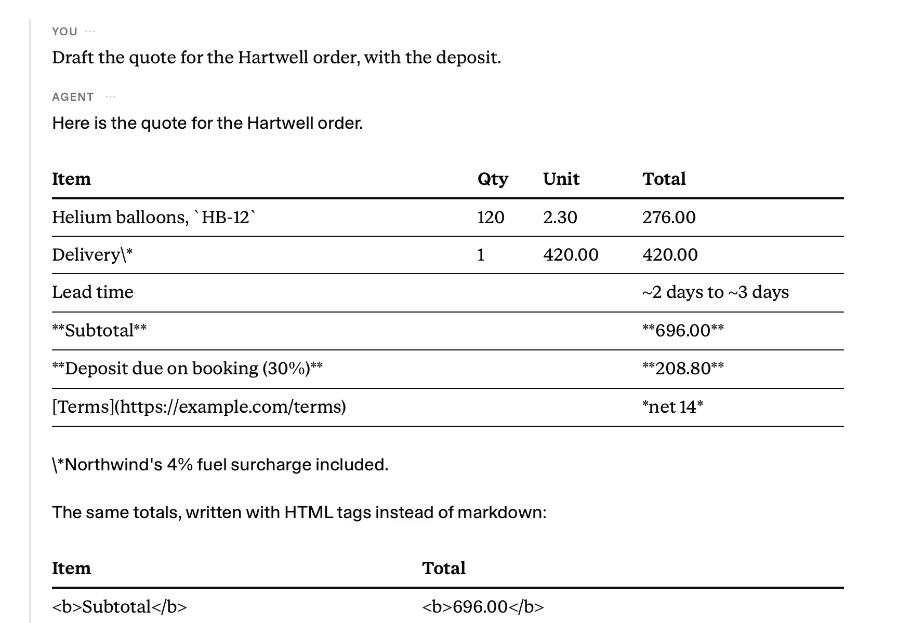
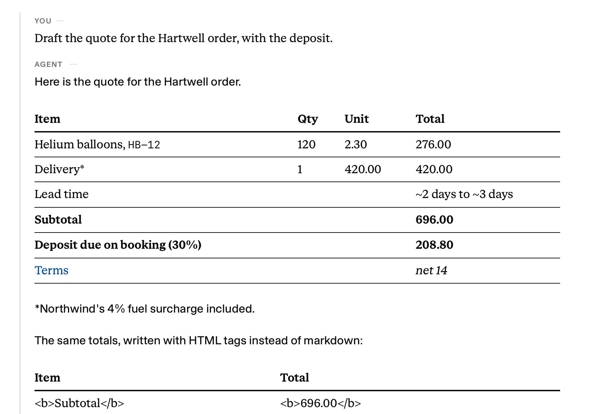
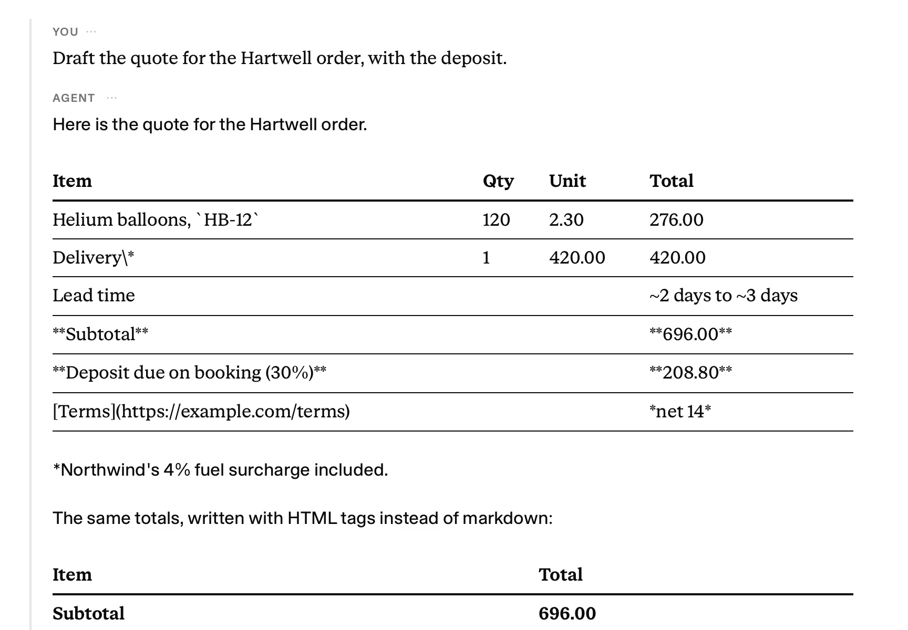
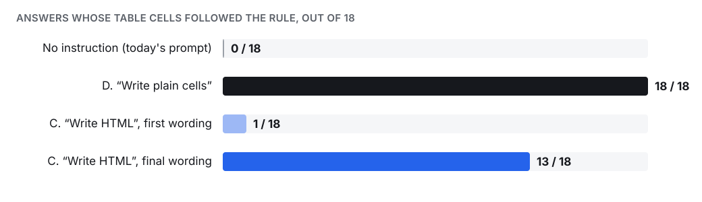
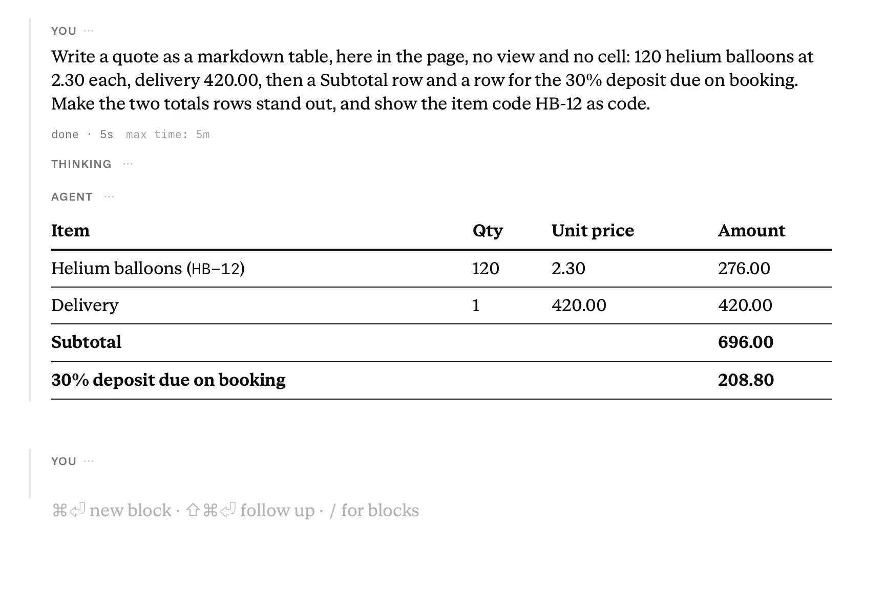
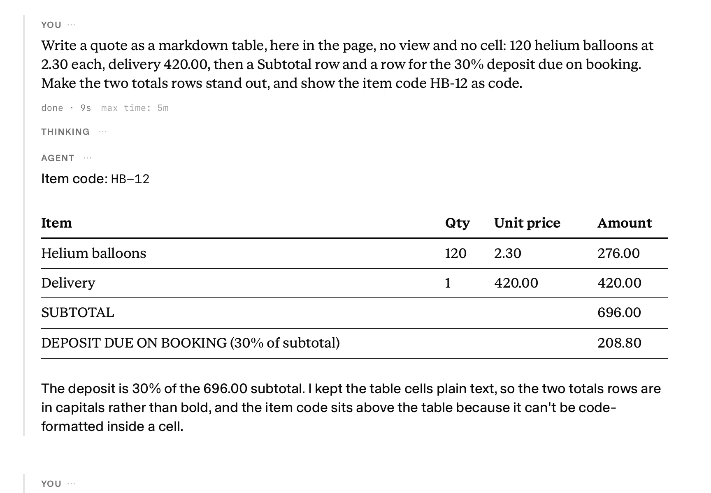
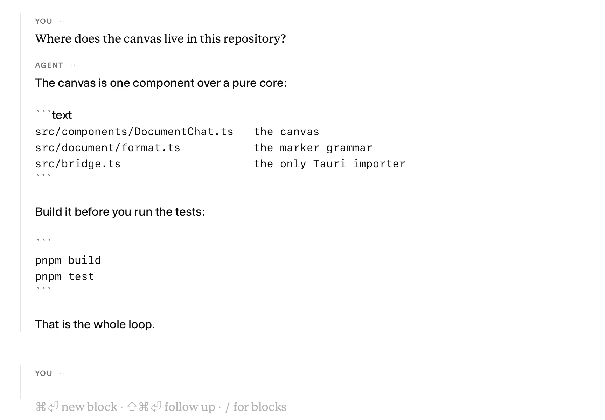
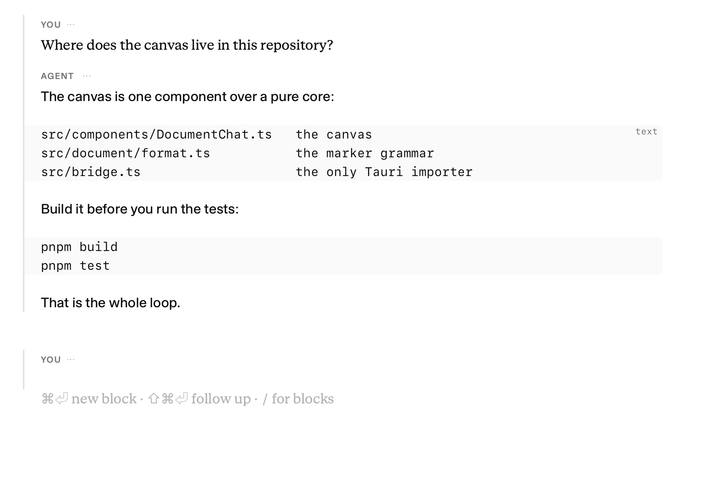

# The agent was right and the page was wrong

*Divergenz. November 2026.*

A user asked our AI agent for a quote. The answer came back as a table, and the two rows that mattered read `**Subtotal**` and `**696.00**`, stars and all. The user said it looked broken and asked the agent to take the stars out. The agent apologised, rewrote the table, and the stars were still there.

The agent was not being stubborn. It was writing correct markdown, the same markdown that renders as bold on GitHub, in Obsidian and in every chat product. Our application was the one place that did not draw it.

This is a follow-up to [Code or catalog? How we decided what an AI agent draws with](../code-or-catalog/article.md). That article was about a large decision. This one is about a small bug, and about a question that comes up every week when you build on a language model: **when the model's output looks wrong on your screen, do you change the model's instructions or do you change your screen?** We built the answer four ways, recorded each one, measured the two that touch the prompt, and merged one. The whole thing took an afternoon, which is part of the point.

## Where the bug lived

Piary is a desktop application in which a conversation with an agent is a plain markdown document. You and the agent write into the same file, and everything stays editable. The editor shows the markdown "live": the stars around a bold word hide while your caret is somewhere else and come back when you move into the word, the way Obsidian's Live Preview and Typora do it.

Tables are the exception. A table is drawn as a real grid whose cells you click and type into. That grid filled each cell with the cell's raw text. Bold, code, links and backslash escapes inside a cell were never looked at.

<table>
<tr><td></td><td></td></tr>
<tr><td colspan="2"><sub><b>Figure 1. The bug.</b> The same answer before and after the fix. Before: stars, backticks, a link with its address, and <code>\*</code> with its backslash. The data in every example here is invented.</sub></td></tr>
</table>

We found this through a loop we run on the application: simulated users, each with a persona and a task, driving the real app and writing down where they got lost. Two of them tripped over the same stars, and a third over the code-block problem described further down. One of them is the user in the opening paragraph.

## Four ways to make the stars go away

There were two places to fix this, the page and the prompt, and two ways to do each. We built all four on separate branches from the same starting commit.

**A. Draw cells from the editor's own parser.** The editor already parses the whole document, table cells included, into a syntax tree; the prose is drawn from it. Read each cell's part of that tree and build the cell from it.

**B. Draw cells with a second markdown library.** We already ship `marked` for another feature. Hand it each cell's text and build the cell from its tokens. Less code.

**C. Draw HTML in cells, and tell the agent to write HTML.** This was suggested in review: perhaps cells could show `<b>Subtotal</b>`, and the agent could be told to write that. It turned out cells did not render HTML either, so this one needed a renderer *and* a line in the system prompt.

**D. Change nothing on the page. Tell the agent to write plain cells.** One sentence in the system prompt: cells are shown as typed, so no bold, code or links inside them.

A, B and C share one piece of behaviour that we were not willing to give up: a cell is still edited in place. Click a rendered cell and it shows its markdown source; what you type is what gets written to the file; click away without typing and nothing changes. That rule came from a test written before any of the four was built, because the obvious implementation has an ugly failure: render the cell, let the user focus it, and on blur write the *rendered* text back, quietly deleting the stars from the document.

<table>
<tr><td></td><td></td></tr>
<tr><td></td><td></td></tr>
<tr><td colspan="2"><sub><b>Figure 2. One document, four builds.</b> A and B draw the same picture. C draws the lower table, the one written with HTML tags, and leaves the upper one, written in ordinary markdown, exactly as broken as before.</sub></td></tr>
</table>

Figure 2 already says something about C. A renderer that only understands HTML fixes nothing that has already been written. Every existing conversation with a starred table stays broken, and so does any table a person types by hand, because people type markdown.

## Measuring the prompt

C and D depend on the model doing what a sentence tells it. So we measured that: three requests that tempt a table with emphasis in it (a quote with totals, a vendor comparison with a winner, a list of commands), six runs each, eighteen answers per variant, scored by a script that reads the table cells.

<table>
<tr><td></td></tr>
<tr><td><sub><b>Figure 3. Does the agent do as it is told?</b> Answers out of 18 whose table cells followed the variant's rule. One model (Claude Sonnet 5.5), three requests, six runs each. "No instruction" is scored against the plain-cells rule: left alone, the model put markup in a cell every single time.</sub></td></tr>
</table>

Three things came out of it.

**Left alone, the model always marks up cells.** Zero of eighteen answers had plain cells. That is not a model defect. It is what a table of totals should look like.

**The plain-cells instruction is obeyed perfectly, and the answers get worse.** Eighteen of eighteen. But a model that wants to emphasise a row and has been told it cannot will find another way. The winner of the vendor comparison became `Carrow & Sons (CHOSEN)`. Commands lost their code styling. In the recording we made of this variant, the totals rows came back in capitals, followed by a sentence from the agent explaining that it had used capitals because cells cannot be bold. We had taught the agent to apologise for our renderer.

<table>
<tr><td></td><td></td></tr>
<tr><td colspan="2"><sub><b>Figure 4. The same request, answered live.</b> Left, build A: the agent writes ordinary markdown and the page draws it. Right, build D: the agent obeys the plain-cells rule, shouts the totals, moves the item code out of the table, and explains itself. One answer each, on Claude Haiku 5.5.</sub></td></tr>
</table>

**The HTML instruction is fragile.** Our first wording, a short one, was followed once in eighteen. The model kept writing stars until the sentence also *claimed* that cells render HTML. With that longer wording, thirteen of eighteen answers were clean. Of the five that were not, two had over-learned the lesson and replaced the whole markdown table with a raw `<table>` block, which the page shows as text, and three used `<sup>`, a tag outside the small list the renderer accepts. An instruction that names a list of allowed tags is a second copy of the renderer's code, kept in English, and the two drift.

There is a quieter cost too. Both instructions are paid for on every turn of every conversation, whether or not a table is involved, and we keep the always-on guidance under a size budget. Each of these lines needed the budget raised.

## Two parsers are one too many

That left A and B, which look identical in Figure 2. B is about forty lines shorter. We still chose A, for one reason: **B puts two markdown parsers in charge of one document.**

Markdown is famous for its edge cases, and two implementations never agree on all of them. We ran both builds over 53 cell texts. They agreed on 49. The four disagreements:

| Cell text | Editor's parser (A, and the prose) | `marked` (B) |
|---|---|---|
| `H~2~O` | H\~2\~O, as typed | H, a struck-through 2, O |
| `~word~` | \~word\~, as typed | struck through |
| `www.example.com` | plain text | a link that opens |
| `name@example.com` | plain text | a mail link |

None of these is a bug in either library. The spec leaves room, and each made a defensible choice. But in our editor the same text can be seen two ways: as a rendered grid, and, when you arrow into the table to change its structure, as raw markdown drawn by the editor. With B, a cell could be struck through in one view and not in the other. With A that cannot happen, because there is only one opinion about what is bold. The extra forty lines buy the absence of a whole category of bug report.

One rule from the security side applied to all three renderers: cell text comes from a model's output, so it is never turned into HTML and handed to the browser. Each build produces a small list of typed runs (text, bold, code, link) and creates elements from that list one by one. A link in a cell opens only on a modified click and only if its address passes the same check as links in prose.

## What we chose

| | A. Editor's parser | B. `marked` | C. HTML + prompt | D. Prompt only |
|---|---|---|---|---|
| New answers | fixed | fixed | fixed when the model complies | no stars, no emphasis |
| Old documents, hand-typed tables | fixed | fixed | still broken | still broken |
| Parsers for one document | one | two | one, plus a tag scanner | one |
| Added to the system prompt | nothing | nothing | 241 characters | 184 characters |
| Model followed it | n/a | n/a | 13 of 18 | 18 of 18 |
| The same file on GitHub | renders | renders | renders, noisier source | flat tables |

We merged A. The prompt did not change by a character.

The same loop had reported a second complaint of the same kind, and we fixed it the same way. A code block in an answer showed its two fence lines, the ```` ```text ```` above it and the ```` ``` ```` below, and a reader took them for a block that had failed to render. The fence lines now hide while the caret is away and come back when it enters the block.

<table>
<tr><td></td><td></td></tr>
<tr><td colspan="2"><sub><b>Figure 5. Fence lines.</b> Before and after. The block keeps a tint and a small label naming its language, so it still reads as code. Nothing in the file changes; put the caret in the block and the fences are back.</sub></td></tr>
</table>

That one took more care than it looks. In our file format a fenced block is also how machine payloads are stored (a cell's source, a tool's output), and those fences must stay visible and honest. So the rule is not "hide fences" but "hide the fences of a code block that sits in prose", and the editor decides what is prose from the document's structure, never from the language named on the fence.

## The file is the interface

The reason this decision was easy in the end is a principle we already had. A Piary conversation is a markdown file that should read cleanly in any markdown tool. John Gruber's original description of Markdown says a document should be "publishable as-is, as plain text, without looking like it's been marked up with tags or formatting instructions". If our agent writes `<b>Subtotal</b>` because our renderer needs it, the file has started to look like our implementation. If it writes `SUBTOTAL` because our renderer cannot do bold, the file is worse for every reader, including the ones using other tools.

There is an older rule that fits as well, Postel's robustness principle from the early internet: be conservative in what you send and liberal in what you accept. The model sends standard markdown. The conservative, standard thing was already happening on its side. The liberal acceptance was our job.

## What we would tell another team

**Check who is wrong before you write an instruction.** When model output looks broken, open it in another tool. If it renders there, the bug is yours. Our user asked the agent to remove the stars, and the agent could not, because the stars were correct.

**A prompt line is code you cannot test, running on every request.** It costs tokens every turn, it competes for the model's attention with everything else you have told it, and it goes stale silently. Our plain-cells sentence would have become false the day anyone fixed the renderer. Use the prompt for what only the model can know; fix rendering in the renderer.

**A model told to avoid something will route around it.** Forbidding bold did not remove the wish to emphasise a row. It moved it into capital letters and an apology. Measure the answer, not just the compliance.

**Build the alternatives when they are cheap, and film them.** Four branches and nine short recordings cost one afternoon with an agent doing the building. The recordings settled in a minute what a discussion about "should the model write HTML?" could have stretched over days. The suggestion was reasonable; the video of thirteen-in-eighteen was more persuasive than any argument against it.

**Prefer one parser.** If two components draw the same text, they should share one reading of it, even at the price of more code.

## Limits

- The compliance numbers come from one model, three requests and eighteen answers per variant. A second model was planned and was unavailable on the day. The live recordings are single answers on a smaller model.
- "Clean" was scored by a script reading table cells. It checks the rule, not whether the table is good.
- We forced a markdown table in two of the three requests. Asked for "a table" with no further steer, our agent drew a designed view two times in three and wrote a markdown table one time in three, so the bug met fewer users than the eighteen-of-eighteen baseline suggests. It met them badly when it did.
- The 53-cell corpus was written by us, with edge cases in mind. Ordinary cells agree across parsers.

## References

**Our earlier article**

- Divergenz, [Code or catalog? How we decided what an AI agent draws with](../code-or-catalog/article.md) (November 2026)

**Markdown, its goals and its edges**

- John Gruber, [Markdown: Syntax](https://daringfireball.net/projects/markdown/syntax) (2004), "Philosophy"
- [CommonMark Spec 0.31.2](https://spec.commonmark.org/0.31.2/)
- [GitHub Flavored Markdown Spec](https://github.github.com/gfm/), tables and strikethrough extensions
- John MacFarlane, [Beyond Markdown](https://johnmacfarlane.net/beyond-markdown.html), on why implementations disagree
- GitHub Docs, [Organizing information with tables](https://docs.github.com/en/get-started/writing-on-github/working-with-advanced-formatting/organizing-information-with-tables)

**Live-rendered markdown editors**

- Obsidian, [Views and editing mode](https://help.obsidian.md/edit-and-read) (Live Preview)
- [Typora](https://typora.io/)
- CodeMirror, [System Guide](https://codemirror.net/docs/guide/), and the [Lezer](https://lezer.codemirror.net/) parser system
- [marked](https://marked.js.org/)

**Instructions versus interfaces**

- Anthropic, [Writing effective tools for agents](https://www.anthropic.com/engineering/writing-tools-for-agents)
- [Robustness principle](https://en.wikipedia.org/wiki/Robustness_principle) (Postel's law)
- [A2UI](https://a2ui.org/), the declarative catalog the earlier article is about
